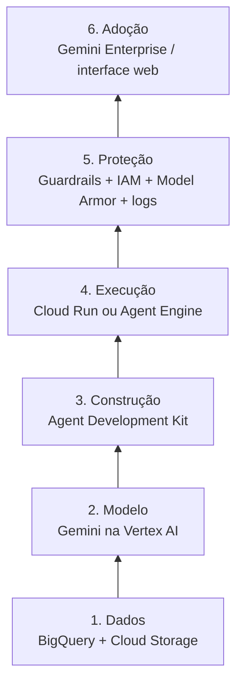

# Agente de IA com BigQuery no Google Cloud (ADK)

Agente de pré-vendas que responde perguntas de negócio **somente com dados do BigQuery**, construído com o **Agent Development Kit (ADK)** e o **Gemini na Vertex AI**.

O foco do projeto não é o modelo: é a pilha completa que leva um agente para produção com segurança.

## As 6 camadas



| Camada | Neste repositório |
|---|---|
| Dados | Tools `listar_tabelas` e `consultar_bigquery` (`agent.py`) |
| Modelo | `gemini-2.5-flash` via Vertex AI (configurável em `MODELO_GEMINI`) |
| Construção | `root_agent` do ADK com instruções e tools tipadas |
| Execução | `deploy.sh` publica no Cloud Run com `adk deploy cloud_run` |
| Proteção | `guardrails.py`: só SELECT, datasets permitidos, LIMIT obrigatório, teto de bytes faturados |
| Adoção | Interface web do ADK (`--with_ui`) para o time testar |

## Guardrails de SQL

Toda consulta gerada pelo agente passa por `validar_sql` antes de chegar ao BigQuery:

- aceita apenas uma instrução `SELECT`/`WITH`;
- bloqueia `INSERT`, `UPDATE`, `DELETE`, `DROP`, `MERGE` e similares, mesmo escondidos em comentários;
- exige o nome completo `projeto.dataset.tabela` e só permite datasets da política;
- força `LIMIT` (padrão 200) e define `maximum_bytes_billed` (padrão 1 GB);
- marca os jobs com labels `origem=agente-ia` para auditoria de custo.

Os guardrails são código Python puro e têm testes (`test_guardrails.py`).

## Como rodar

```bash
git clone https://github.com/MoniqueSilva79/agente_bigquery_adk.git
cd agente_bigquery_adk
python -m venv .venv && source .venv/bin/activate
pip install -r requirements.txt
cp .env.example .env   # preencha projeto, região e datasets
gcloud auth application-default login

pytest                 # testes dos guardrails
cd .. && adk web       # abre a interface do ADK e escolha agente_bigquery_adk
```

> O nome da pasta precisa continuar `agente_bigquery_adk` (com underscores), porque o ADK importa a pasta como pacote Python.

## Deploy no Cloud Run

```bash
export GOOGLE_CLOUD_PROJECT=seu-projeto
export GOOGLE_CLOUD_LOCATION=us-central1
./deploy.sh
```

O script cria uma conta de serviço com papéis mínimos (`bigquery.dataViewer`, `bigquery.jobUser`, `aiplatform.user`) e faz o deploy com o CLI do ADK.

## Segurança em produção (recomendado)

- **Model Armor**: crie um template e aplique na entrada e na saída do agente para filtrar prompt injection, jailbreak e dados sensíveis.
- **IAM**: o agente roda com conta de serviço própria, só com leitura nos datasets permitidos.
- **Logs**: os jobs carregam labels e ficam no histórico do BigQuery e no Cloud Logging.
- **Dados sensíveis**: use views autorizadas ou políticas de coluna em vez de expor tabelas brutas.

## Estrutura

```
agente_bigquery_adk/
├── __init__.py        # o ADK procura root_agent em agent.py
├── agent.py           # agente, instruções e tools
├── guardrails.py      # regras de segurança para SQL
├── test_guardrails.py # testes
├── deploy.sh          # deploy no Cloud Run
├── requirements.txt
└── .env.example
```

---
Autora: **Monique Silva** · Pré-vendas Cloud & IA · 7x certificada Google Cloud
